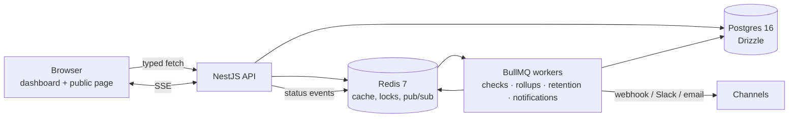

# StatusBeam

> Distributed-ish uptime checks, incident lifecycle, and a public status page with live
> updates — built to prove typed backend engineering, not to sell uptime.

[](https://github.com/supremeyuma/statusbeam/actions/workflows/ci.yml)

StatusBeam schedules HTTP and TCP checks with BullMQ, prevents duplicate runs with a Redis
lock, opens incidents only after hysteresis, fans notifications out to webhook/Slack/email
with retries and a dead-letter queue, and streams status changes to a public Next.js page
over SSE.

**Status:** honestly scoped demo — the live deploy is deferred (no server/account was
available). Everything below runs locally with `docker compose`; the Playwright smoke and
load numbers are from this machine.

## What it does

- **Monitors** — HTTP (status/body/regex/latency assertions) and TCP port checks, 30–3600s
  intervals, retries, timeouts, SSRF protection.
- **Scheduler** — one repeatable BullMQ job per monitor plus `SET NX PX` + compare-and-delete
  Redis lock; duplicate checks are skipped and counted.
- **Checks + rollups** — raw checks kept 7 days, hourly rollups kept 90 days, nearest-rank
  p95, idempotent recompute, daily retention job.
- **Incidents** — explicit `investigating → identified → monitoring → resolved` machine,
  open after N consecutive failures, resolve after 2 successes, invalid transition = 409 with
  allowed transitions.
- **Notifications** — signed webhooks (HMAC), Slack blocks, Resend/SMTP email; 5
  exponential-backoff attempts; `notification-dlq` with replay through the original jobId.
- **Public status** — allowlisted snapshot, 90-day bars, 10s Redis cache, ETag/304, 60/min/IP,
  SSE with heartbeat, `Last-Event-ID` replay, and incident-preserving backpressure.
- **Dashboard** — login/register, project switcher, monitor CRUD, latency history,
  incident editor, channel configuration, one-time API key display.

## Architecture



One API process runs the HTTP server and workers; the scheduler and notification queues are
separate so a slow provider cannot block checks. Each monitor has exactly one repeatable
job; workers race for a per-monitor lock, so adding replicas does not double-check.

## Measured results

Load test: 1,000 HTTP monitors at a 30s interval against a local target, one API container
with a 5-slot check worker, Docker Desktop (WSL2) on Windows 11.

| Metric                                 | Result                                  |
| -------------------------------------- | --------------------------------------- |
| Hardware                               | Intel i7-14650HX, 24 cores, 31.6 GB RAM |
| Checks observed in 62s window          | 7,000 (~113 checks/s)                   |
| Scheduler lag p50 / p95 / p99          | **0.76s / 1.84s / 1.97s**               |
| Check duration p95 / p99               | **9.5ms / 9.9ms**                       |
| API request p95 (probe under load)     | **4.7ms**                               |
| API / Postgres / Redis memory (sample) | 83 MB / 72 MB / 19 MB                   |
| Skipped checks (duplicate lock)        | 0                                       |

Method: `pnpm load:seed -- --count 1000`, then `pnpm load:measure -- --minutes 2`; raw JSON
in [`load/results/`](load/results). Lag is `worker start − (job creation + scheduled delay)`,
not queue age. The 5,000-monitor target in the plan was not run on this laptop; 1,000 is the
honest reproducible number, and the plan's documented fallback explicitly allows it.

## Run it

Prerequisites: Docker Desktop (Linux containers), Node 22, pnpm 12.

```powershell
Copy-Item .env.example .env
docker compose -f infra/docker-compose.yml up -d --build
pnpm install
pnpm dev:web
```

- API: <http://localhost:3001> — `/healthz`, `/readyz`, `/metrics`, `/openapi.json`
- Dashboard: <http://localhost:3000/login>
- Public page: `http://localhost:3000/<project-slug>` (create a public project first)

Host ports are reserved for this project: Postgres `5433`, Redis `6380`, API `3001`, web
`3000`.

Verify the repo:

```powershell
pnpm verify          # format, lint, typecheck, 120 API tests, contracts + API + Next build
pnpm contracts:gen   # regenerate openapi.json + typed client (reproducible)
```

Playwright smoke (expects the compose API on 3001 and a public project created by the test):

```powershell
pnpm --filter @statusbeam/web exec playwright install chromium
pnpm --filter @statusbeam/web exec playwright test
```

Production-style stack and deploy notes: [`infra/docker-compose.prod.yml`](infra/docker-compose.prod.yml),
[`docs/deploy.md`](docs/deploy.md).

## Design decisions

1. **Repeatable job per monitor + Redis lock, not one cron loop.** A single loop hides per-
   monitor failures and collapses under load. `upsertJobScheduler('monitor:<id>', …)` keeps
   one schedule per monitor across deploys; the lock makes duplicate delivery harmless.
2. **Hysteresis in the evaluator.** Incidents open after `retries` consecutive failures and
   resolve after two successes, derived from a 20-check window. Flapping never spams.
3. **SSE, not WebSocket.** Status is one-way. SSE reconnects natively, and `Last-Event-ID`
   replays from a capped Redis stream.
4. **Recompute rollups, never increment.** `ON CONFLICT … DO UPDATE` makes backfills and
   reruns idempotent; `percentile_disc` gives nearest-rank p95.
5. **Cache the public snapshot, invalidate on incidents.** 10s TTL bounds staleness; incident
   publishes delete the key so the page flips immediately.
6. **Typed contracts from one place.** Zod schemas drive validation and OpenAPI; the web app
   imports the generated client, so a renamed field is a compile error.

## Security notes

- Argon2id passwords, 15-minute access JWT, rotating 30-day refresh token hashed in Postgres,
  family revocation on reuse, HttpOnly/Secure/SameSite=Strict cookie.
- API keys are `sb_live_…` secrets stored as SHA-256 with a prefix; scopes are enforced per
  route; last-used updates at most once per minute.
- SSRF guard resolves every target (create and check time) and rejects loopback, private,
  link-local, CGNAT, multicast, and reserved ranges unless `ALLOW_PRIVATE_TARGETS=true`
  (tests/dev only). URL credentials are rejected.
- The public API returns an allowlisted snapshot; monitor configs, headers, URLs, channel
  secrets, and API key hashes never leave the API.
- Pino redacts `authorization`, `cookie`, and `x-api-key` headers. Error envelopes include a
  request id but no stack traces.
- Webhook signatures: `X-StatusBeam-Signature: t=<unix>,v1=<hex hmac>` over `${t}.${body}`.

Details: [`docs/security.md`](docs/security.md).

## Cost

Rough monthly cost, assuming one check/60s, 7-day raw retention, 90-day rollups:

| Scale         | Raw checks retained         | Suggested shape                                 | Cost      |
| ------------- | --------------------------- | ----------------------------------------------- | --------- |
| 1k monitors   | ~10M rows                   | 1× 2 vCPU/4 GB VPS + Docker                     | ~$20–30   |
| 10k monitors  | ~100M rows                  | 2–3 API/worker nodes, managed Postgres, Redis   | ~$150–250 |
| 100k monitors | ~1B rows (partition checks) | partitioned Postgres/Timescale, sharded workers | $1k+      |

These are estimates, not invoices. The interesting constraint at 100k is raw write volume,
not CPU; the plan's "what I'd do next" is partitioning `checks` by day.

## What I'd do next

- Multi-region probes and per-region status aggregation.
- Partition/compress `checks` instead of delete-based retention at 10k+ monitors.
- Notification escalation policies and on-call schedules.
- Per-project rate limits and audit log for API keys.
- Multi-worker load test at 5,000 monitors with a dedicated Postgres host.

## Docs

- [Execution plan](docs/plan.md) · [Roadmap + gate evidence](docs/roadmap.md) · [Spec](docs/spec.md)
- [Case study](docs/case-study.md) · [Failure modes](docs/failure-modes.md) · [Security](docs/security.md)
- [Interview notes](docs/interview-notes.md) · [Deploy](docs/deploy.md)
- ADRs: [repeatable jobs](docs/adr/001-repeatable-jobs-vs-cron.md) ·
  [SSE](docs/adr/002-sse-vs-websocket.md) · [rollups](docs/adr/003-rollups-and-retention.md)

## License

MIT
