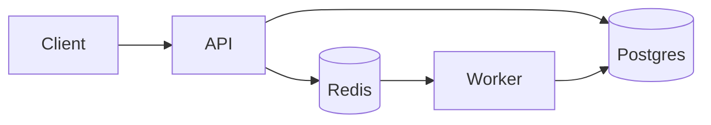

# {Project Name}

> One sentence: what it does, for whom, and the one number that makes it interesting.

[](...)
[](LICENSE)

**Demo:** {live URL or 60–90s video}
**Stack:** Python 3.12 · FastAPI · Postgres · Redis · Docker

## The problem

Two or three sentences. Make the reader feel the pain. No marketing.

## What it does

- Bullet 1 — observable behaviour
- Bullet 2
- Bullet 3

## Architecture



Three to five bullets on **why** this shape:
- Chose X over Y because … (tradeoff)
- Failure mode handled by …

## Measured results

| Metric | Value | How |
|---|---|---|
| Ingest throughput | 1,000 req/s | `k6 run load/ingest.js`, 4 vCPU |
| p95 latency | 41 ms | same run |
| Test coverage | 87% | `pytest --cov` |

Do not publish numbers you can't reproduce.

## Run it

```bash
cp .env.example .env
docker compose up --build
# API: http://localhost:8000/docs
```

## Tests

```bash
docker compose run --rm api pytest -q
```

## Design decisions

- **{Decision}** — context, options, choice, consequence. Link the ADR.
- **{Decision}** — …

## Security notes

Secrets, signature verification, rate limits, input caps, what is intentionally not handled.

## What I'd do next

Honest list with the reason each was cut. This section signals judgement, not gaps.

## License

MIT
